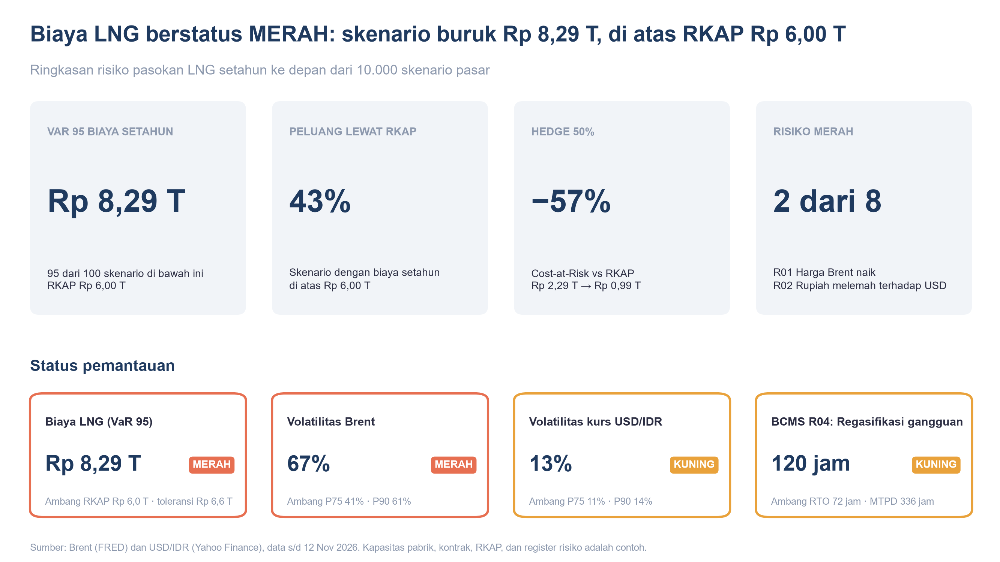
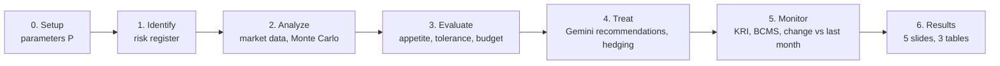
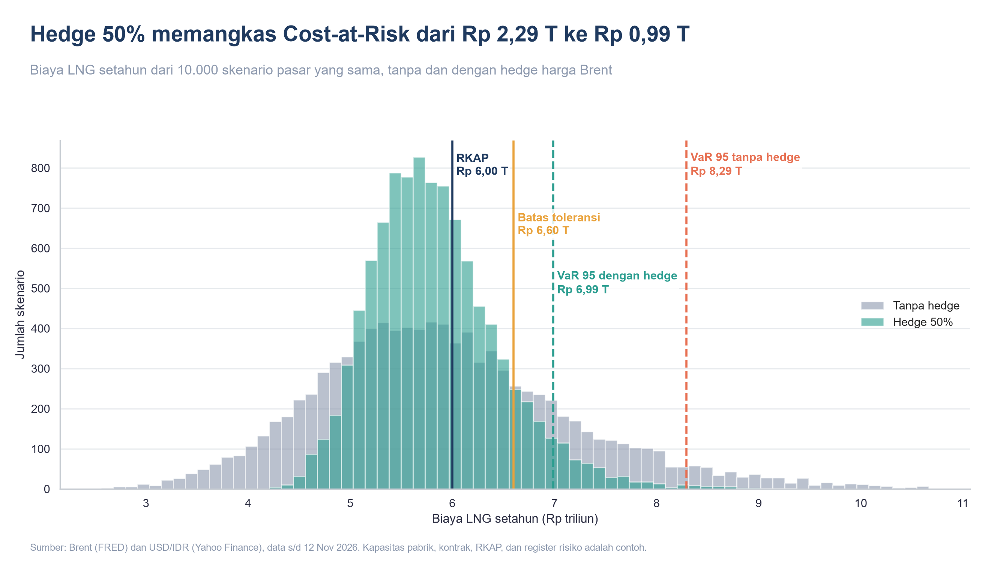
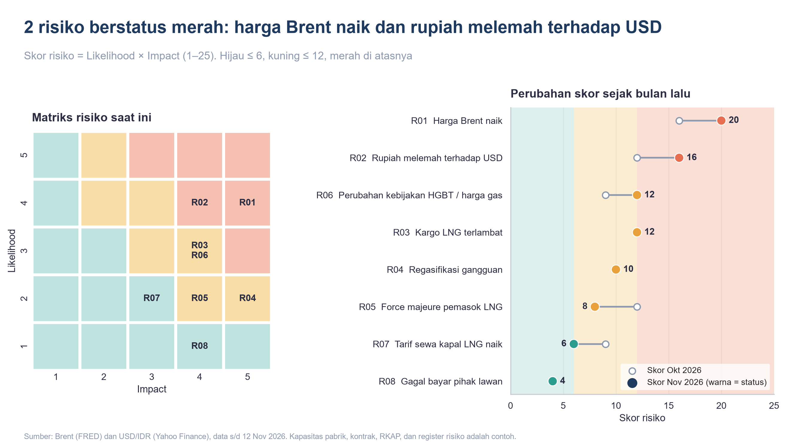
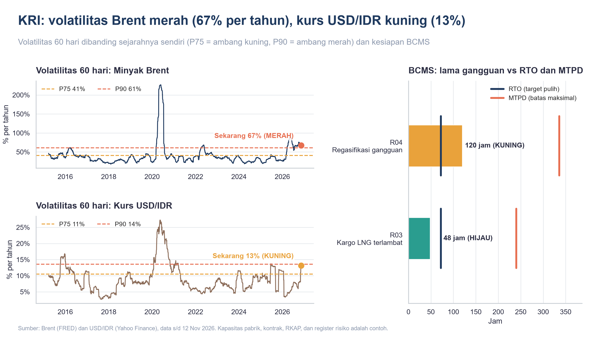
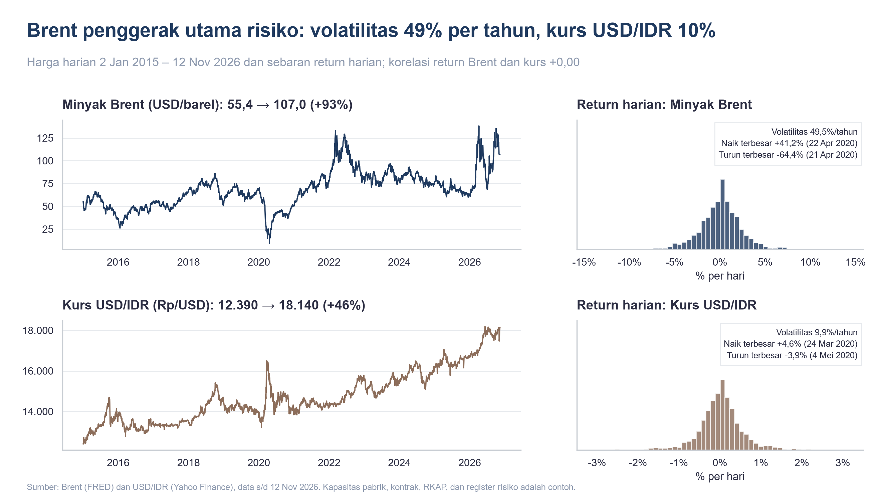

# LNG Supply Risk Analysis

[](https://colab.research.google.com/github/aldo02032004/lng-supply-risk-analysis/blob/main/lng_supply_risk_analysis.ipynb)


A risk management model for the cost of LNG supply at an Indonesian ammonia-urea (fertilizer) plant. It follows the five steps of **ISO 31000** (identify, analyze, evaluate, treat, monitor) and ends with five presentation-ready charts.

The LNG price is indexed to Brent crude oil and paid in Indonesian Rupiah, so the plant carries two market risks: the oil price and the exchange rate. A Monte Carlo simulation on real market data turns those risks into a budget question: **how far can next year's LNG cost exceed the budget, and how much does hedging help?**



## Questions answered

1. Which risks have the highest priority?
2. How far can next year's LNG cost exceed the budget (RKAP)?
3. How much does hedging reduce that risk?
4. What needs continuous monitoring (key risk indicators, business continuity)?

## Pipeline



Sections 0–5 only compute. Every table and chart is collected in **section 6**, so a reader can go straight to the results.

| Step | What happens | Main output |
|---|---|---|
| 0. Setup | All assumptions in one `P` dictionary | Annual gas demand (MMBtu) |
| 1. Identify | Eight risks rated by likelihood and impact (1–5) | `reg` |
| 2. Analyze | Daily Brent and USD/IDR, log returns, 10,000-scenario bootstrap simulation of next year's cost | `cost`, `m`, `m_hedge` |
| 3. Evaluate | Scores vs appetite/tolerance, VaR vs budget | Green / yellow / red status |
| 4. Treat | One Gemini call recommends a mitigation for every yellow/red risk | `reg["rekomendasi"]` |
| 5. Monitor | 60-day volatility vs its own history, downtime vs RTO/MTPD, metrics vs last month | `kri`, `bcms`, `m_lalu` |
| 6. Results | Five 16:9 slides (summary, cost and hedging, risk register, monitoring, market data) and three tables | `images/01-05_*.png` |

The full technical description (inputs, formulas, status rules, outputs, variable names) is in [docs/SPECIFICATION.md](docs/SPECIFICATION.md).

## Data

| Variable | Source | Code | Frequency |
|---|---|---|---|
| Brent crude oil (USD/barrel) | [FRED](https://fred.stlouisfed.org/series/DCOILBRENTEU), U.S. EIA | `DCOILBRENTEU` | Daily |
| USD/IDR exchange rate | Yahoo Finance via `yfinance` | `IDR=X` | Daily |

Data is downloaded on every run from 2015 to the latest available date (about 3,000 daily rows per series). A copy is saved in `data/` and used when a download fails. Plant, contract, budget, register and BCMS values are **hypothetical examples**.

## Sample results

Run on data up to **12 Nov 2026**. Numbers change every time the notebook runs on newer data.

| Metric | Without hedge | Hedge 50% | Meaning |
|---|---|---|---|
| Mean cost | IDR 5.94 T | IDR 5.83 T | Expected LNG cost for the next 12 months |
| VaR 95% | IDR 8.29 T | IDR 6.99 T | 95 of 100 scenarios cost less than this |
| CVaR 95% | IDR 9.26 T | IDR 7.45 T | Average of the worst 5% of scenarios |
| CaR vs budget | IDR 2.29 T | IDR 0.99 T | How far the budget (IDR 6.0 T) can be exceeded |
| P(cost > budget) | 43% | 35% | Share of scenarios above budget |

Key findings:
- **LNG cost status is red.** VaR 95% (IDR 8.29 T) is above the tolerance limit of IDR 6.60 T (budget + 10%).
- **Hedging 50% of the volume cuts Cost-at-Risk by 57%**, while the mean cost barely changes. Hedging buys predictability, not savings.
- **Brent volatility is in its top 10% historically** (60-day volatility 67% vs a P90 threshold of 61%), so the oil-price KRI is red. FX volatility is yellow.
- **Brent drives most of the risk.** Its annual volatility is about 49%, against about 10% for USD/IDR, and the two are almost uncorrelated, so FX needs its own hedge.

### Charts

Each chart is a 16:9 slide saved in `images/`, with the main message as its title (labels are in Indonesian).






## How to run

**Google Colab (easiest):** click the *Open in Colab* badge and run all cells.

**Locally:**
```bash
git clone https://github.com/aldo02032004/lng-supply-risk-analysis.git
cd lng-supply-risk-analysis
pip install -r requirements.txt
jupyter notebook lng_supply_risk_analysis.ipynb
```

**Gemini recommendations (optional):** set a `GOOGLE_API_KEY` secret in Colab (key icon, enable notebook access) or as an environment variable locally. Without a key the notebook still runs and uses the last saved recommendations in `data/rekomendasi.json`. The notebook makes one API call per run. AI output is a suggestion and must be reviewed by the risk owner.

## Adapting to another case

The notebook is written for LNG at a fertilizer plant, but the pipeline works for any business that buys a commodity priced in a foreign currency: coal for a power plant, jet fuel for an airline, wheat for a flour mill, copper for a cable maker. These are the parts to change:

| What | Where | LNG example | What to change |
|---|---|---|---|
| Price driver series | Section 2.1, `fred("DCOILBRENTEU")` | Brent, daily | The FRED code (or another source) of the price that drives your cost, e.g. `DJFUELUSGULF` (jet fuel), `PCOALAUUSDM` (Australian coal), `PWHEAMTUSDM` (wheat), `PCOPPUSDM` (copper) |
| Currency | Section 2.1, `yf.download("IDR=X")` | USD/IDR | Your local currency pair, e.g. `MYR=X`, `INR=X`. Drop the FX series if you pay in USD |
| Annual volume | `P`: `urea_cap`, `util`, `gas_per_ton`, and `mmbtu` | 22.5 million MMBtu | Your consumption formula, e.g. MWh × heat rate, flights × fuel per flight, tons of flour × wheat per ton |
| Price formula | `P`: `slope`, `const`, and the `price = ...` line in `simulate()` | 0.12 × Brent + 1.5 | Your contract formula. For a spot-priced commodity use `slope=1, const=0` |
| Units in output | `rp()`, `/ 1e12`, chart labels | IDR trillion | Your currency and scale |
| Budget and limits | `P`: `rkap`, `appetite`, `tolerance`, `cost_tol` | IDR 6.0 T, 6, 12, 10% | Your budget and your management's risk limits |
| Risk register | Section 1, `reg` | Eight LNG risks | Your own risks, ratings, owners and deadlines |
| Business continuity | Section 5, `bcms` | Regasification outage, late cargo | Your critical disruptions with downtime, RTO and MTPD |
| Gemini prompt | Section 4, `prompt` | Fertilizer plant buying LNG | Describe your business so recommendations fit it |
| Labels and colors | Setup, `nama` and `warna` | `brent`, `usdidr` | Keys must match the column names in `px` |
| Hedge | `P`: `hedge` | 50% swap on Brent | Your hedge ratio; set `0` to skip |

Things to watch when you adapt:
- **Monthly-only data** (many IMF commodity series on FRED) works for the Monte Carlo, which already uses monthly returns. The volatility KRI assumes daily data (`rolling(60)` and `√252`); for monthly data use something like `rolling(6)` and `√12`.
- **More than two price drivers:** add columns to `px`. The bootstrap keeps working because it draws whole rows; only the price formula in `simulate()` and the column indexes (`paths[..., 0]`, `paths[..., 1]`) need updating.
- **The notebook is in Indonesian**: text, comments and labels (for example `skor`, `rekomendasi`, `Biaya`). A glossary of variable names is in [docs/SPECIFICATION.md](docs/SPECIFICATION.md#variable-glossary).

## Project structure

```
lng-supply-risk-analysis/
├── lng_supply_risk_analysis.ipynb   # main notebook, executed with outputs
├── docs/
│   └── SPECIFICATION.md             # inputs, method, formulas, outputs, glossary
├── data/                            # cached market data and last Gemini recommendations
├── images/                          # 01_ringkasan … 05_data_pasar: the five slides of section 6
├── requirements.txt
├── LICENSE
└── README.md
```

## Limitations

- All plant, contract, budget, register and BCMS values are examples. Appetite and tolerance are management decisions, not model outputs.
- Brent is a proxy for the LNG price because the Asian LNG spot price (JKM) is licensed.
- The bootstrap treats months as independent, so seasonality and mean reversion are not captured.
- Hedging is simplified: no premium, basis risk or credit risk, and only the oil price is hedged.
- Gemini recommendations are suggestions, not decisions.

This project is for learning and portfolio purposes and is not investment advice.

## License

[MIT](LICENSE) © 2026 Naufaldo Indra Pratama
